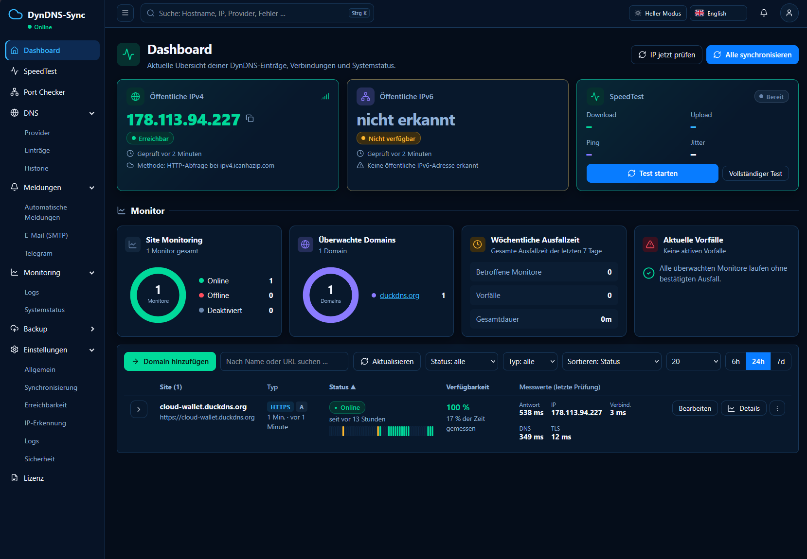
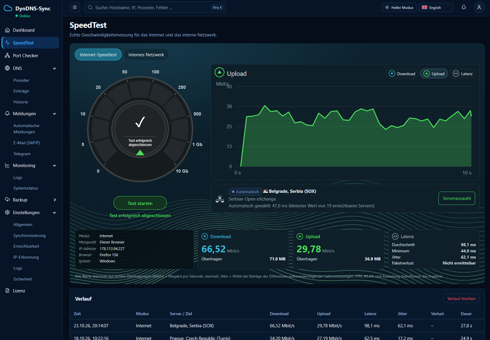
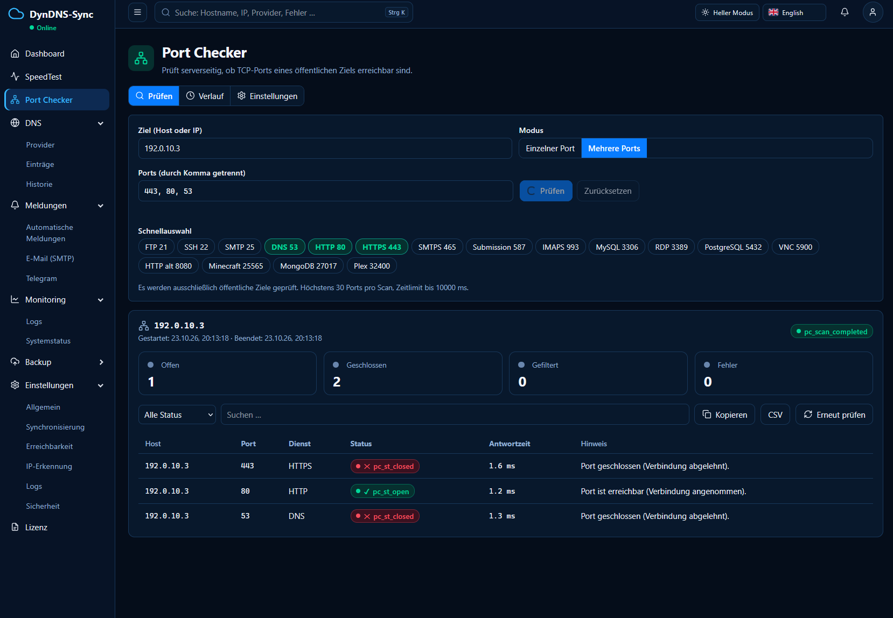
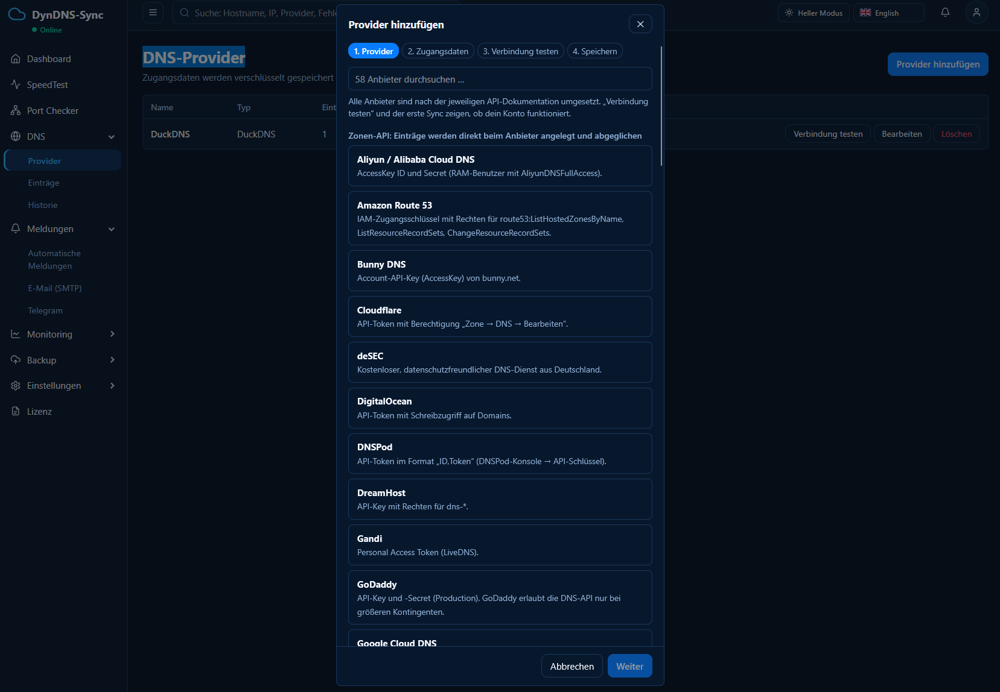
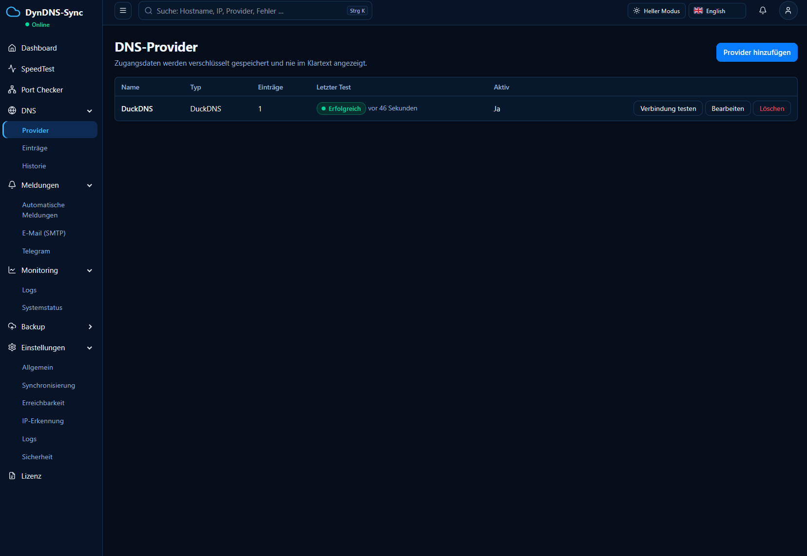
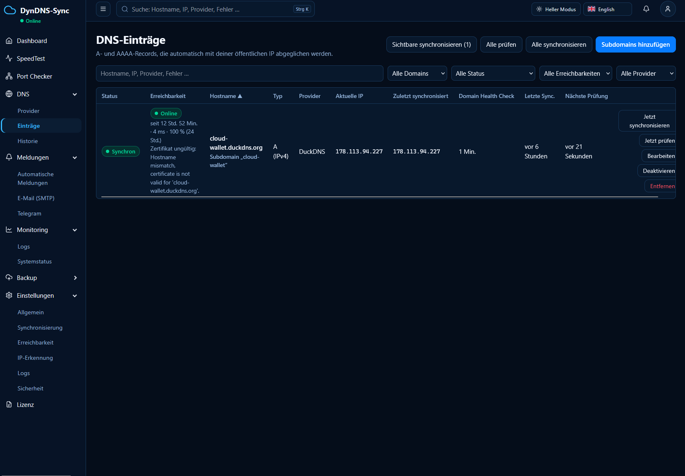
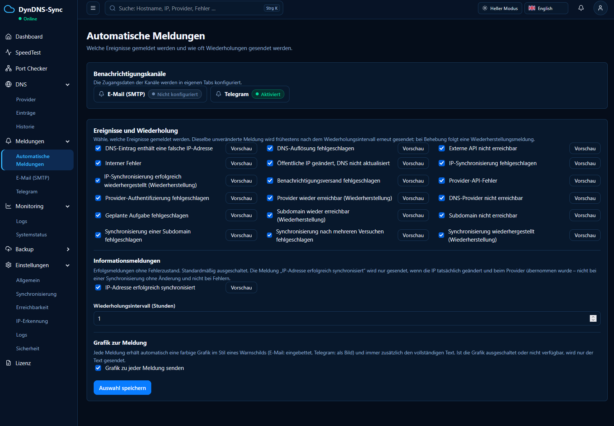
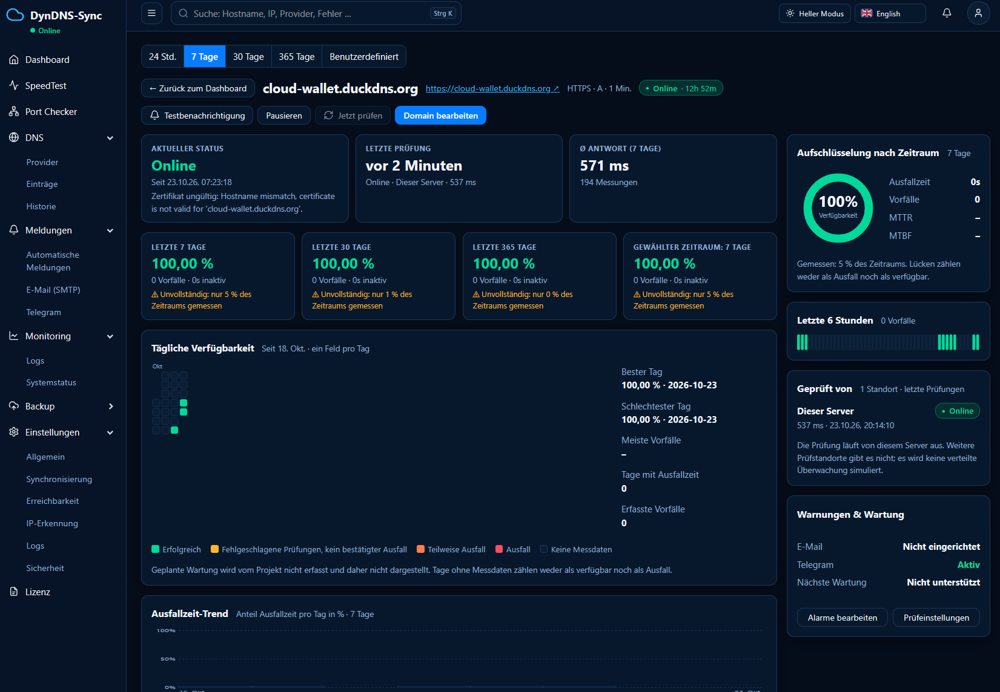

# DynDNS-Sync

**DynDNS-Sync** ist eine webbasierte Plattform zur automatischen Verwaltung dynamischer DNS-Einträge. Sie erkennt Änderungen der öffentlichen IPv4-/IPv6-Adresse, aktualisiert DNS-Records bei unterstützten Providern und überwacht die Erreichbarkeit deiner Domains.

## Screenshots

### Dashboard


### Internet- und Heimnetz-Speedtest


### Port Checker


### DNS-Provider verwalten


### DNS-Einträge


### DNS-Einträge – Übersicht


### Automatische Meldungen


### Domain-Monitoring


## Funktionen auf einen Blick

- **Automatische DNS-Synchronisierung:** A- und AAAA-Records werden bei IP-Änderungen aktualisiert.
- **Breite Provider-Unterstützung:** Anbindung von DNS-Zonen-APIs und klassischen DynDNS-Diensten.
- **Domain Health Check:** Prüft die Erreichbarkeit einer Webseite und vergleicht bei Ausfällen die DNS-IP mit der aktuellen öffentlichen IP.
- **Domain-Monitoring:** Status, Antwortzeiten, Verfügbarkeit, Ausfälle und Prüfverlauf in der Oberfläche.
- **Benachrichtigungen:** Automatische Meldungen per E-Mail und Telegram, mit verständlicher Textmeldung und optionaler Ereignisgrafik.
- **SpeedTest:** Messungen für Internetverbindung und unterstützte Ziele im lokalen Netzwerk.
- **Port Checker:** Prüfen von Netzwerkports.
- **Historie und Protokolle:** Nachvollziehbare Synchronisierungen, Statuswechsel und Fehler.
- **Backup und Wiederherstellung:** Daten sichern, exportieren, importieren und wiederherstellen.
- **Weboberfläche:** Verwaltung direkt im Browser, ohne separaten Frontend-Build.

## Technologie

- Python 3.11+
- FastAPI und REST API
- Vanilla JavaScript
- SQLite mit WAL-Modus
- Docker und Docker Compose
- Server-Sent Events (SSE) für Live-Ereignisse

## Schnellstart mit Docker Compose

Voraussetzung: Docker Engine und das Docker-Compose-Plugin.

```bash
cp .env.example .env
docker compose build
docker compose up -d
```

Öffne anschließend:

```text
http://<SERVER-IP>:8080
```

Beim ersten Aufruf kannst du das Administratorkonto einrichten. Es gibt kein voreingestelltes Standardpasswort. Alternativ können die initialen Zugangsdaten – sofern in der Projektkonfiguration vorgesehen – über `.env` gesetzt werden.

## Persistente Daten

Standardmäßig werden die Anwendungsdaten unter `/DATA/AppData/dyndns-sync` gespeichert:

| Host-Verzeichnis | Inhalt |
|---|---|
| `data/` | SQLite-Datenbank und Schlüsseldatei |
| `backups/` | Sicherungen |
| `logs/` | Anwendungs- und Audit-Protokolle |

Die Daten liegen in persistenten Host-Verzeichnissen und bleiben bei einem Neuerstellen des Containers erhalten. **Wichtig:** Die Schlüsseldatei `secret.key` muss zusammen mit den Backups sicher aufbewahrt werden, da verschlüsselte Provider-Zugangsdaten sonst nicht wiederhergestellt werden können.

## Sicherheit

- Passwort-Hashes mit Argon2id
- Serverseitige Sitzungen und CSRF-Schutz
- Begrenzung von Anmeldeversuchen
- Verschlüsselte Speicherung von Provider-Zugangsdaten
- Container mit schreibgeschütztem Root-Dateisystem vorgesehen
- Zugangsdaten werden bei normalen Exporten standardmäßig ausgelassen

Setze die Anwendung nicht ungeschützt dem Internet aus. Verwende sichere Zugangsdaten und bei externer Veröffentlichung einen korrekt konfigurierten HTTPS-Reverse-Proxy.

## Architektur in Kurzform

```text
Browser
  └── Weboberfläche (Vanilla JavaScript)
       └── FastAPI / REST API / SSE
            ├── DNS-Provider und Synchronisierung
            ├── IP-Erkennung und Domain Health Check
            ├── Monitoring und Benachrichtigungen
            ├── Backup, Import und Wiederherstellung
            └── SQLite + persistente Logs
```

## Hinweise

- Provider-Anbindungen sollten vor dem produktiven Einsatz mit einem echten Konto über **„Verbindung testen“** und einen ersten Synchronisierungslauf geprüft werden.
- Die externe Erreichbarkeitsprüfung erfolgt vom Anwendungsserver aus. NAT-Loopback oder lokale Firewall-Regeln können Ergebnisse beeinflussen.
- Für ARM64-Systeme wie den Raspberry Pi 5 ist ein 64-Bit-Betriebssystem erforderlich, sofern das verwendete Image für `linux/arm64` veröffentlicht wurde.
- Details zu Konfiguration, SpeedTest, Benachrichtigungen und Betrieb findest du in den Dokumentationsdateien des Projekts.

## Lizenz

Bitte beachte die im Repository enthaltene Lizenzdatei, sofern vorhanden.
